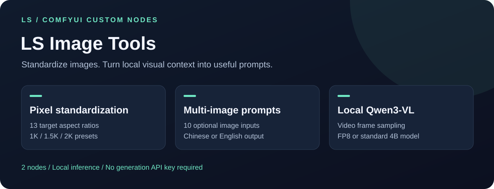
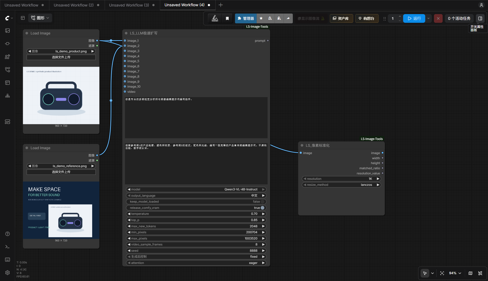
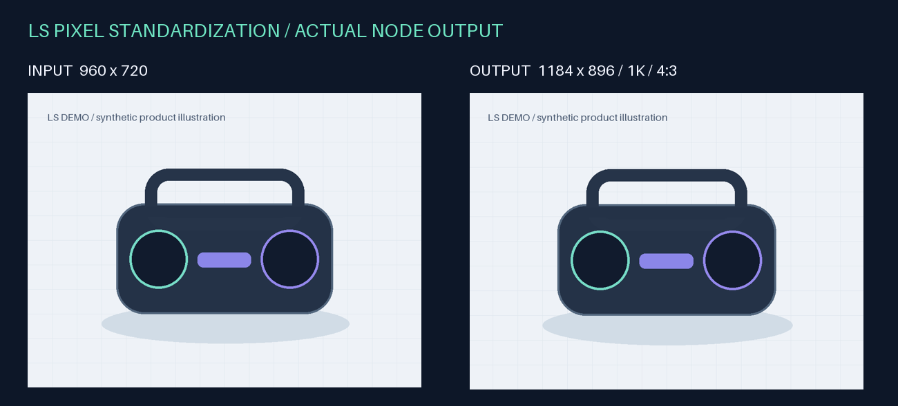
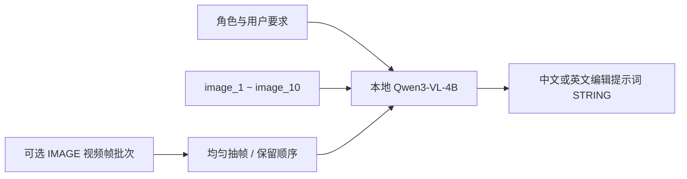

# ComfyUI LS Image Tools



**自动标准化图片尺寸，用本地 Qwen3-VL 将多图和视频抽帧整理为编辑提示词。**

English: Two ComfyUI nodes for image standardization and local Qwen3-VL prompt generation. Supports ten optional image inputs and ordered video-frame sampling. No image-generation API key is needed.

  

## 功能展示



| 节点 | 功能 | 输出 |
| --- | --- | --- |
| LS_像素标准化 | 13 种预设比例自动匹配、等比缩放、居中裁切，支持批次 | IMAGE、宽度、高度、匹配比例、分辨率档位值 |
| LS_LLM极速扩写 | 文字、10 路可选参考图、视频帧顺序抽样，使用本地 Qwen3-VL 扩写 | 中文或英文 STRING 提示词 |

### 像素标准化：真实节点输出



程序绘制的 960×720 演示图，经节点实际处理后输出 **1184×896**，匹配 `4:3`、`1K` 档位。该节点匹配的是预设尺寸，不表示每张图片的长边恰好为 1024。

支持 `1K`、`1.5K`、`2K` 档位及 lanczos、bicubic、bilinear、nearest 插值方式。居中裁切不会拉伸主体，但为匹配目标比例可能裁掉边缘内容。

### 多图与视频提示词



示例要求：

> 保留参考图1的产品轮廓、颜色和材质，参考图2的版式、配色和光线，编写一段完整的产品宣传图编辑提示词。不虚构功能、数字或认证。

这是用户指令示例，不是已经运行模型得到的回答。视频输入分析按顺序标记的帧图片，不分析音频。

## 安装

在 `ComfyUI/custom_nodes` 目录执行：

```bash
git clone https://github.com/diyibaak/ComfyUI-LS-Image-Tools.git
python -m pip install -r ComfyUI-LS-Image-Tools/requirements.txt
```

使用启动 ComfyUI 的 Python，安装后重启并刷新。已经安装旧单文件 `LS_ImageOffset.py` / `LS_LLM_MultiImageEdit.py` 时，先把旧单文件移出 `custom_nodes`，避免重复加载。

PyTorch、NumPy、Pillow 使用现有 ComfyUI 环境；扩写节点需要支持 Qwen3-VL 的 Transformers 与 Accelerate。FP8 的运行条件取决于模型配置、GPU及 Triton 环境。没有 Qwen 模型时，可先单独使用像素标准化节点。

## 本地模型

```text
ComfyUI/models/prompt_generator/
├── Qwen3-VL-4B-Instruct-FP8/
└── Qwen3-VL-4B-Instruct/
```

普通版模型参考：[Qwen/Qwen3-VL-4B-Instruct 官方模型卡](https://huggingface.co/Qwen/Qwen3-VL-4B-Instruct)。自行下载完整权重、配置、分词器和预处理器文件到上述普通版目录。

默认下拉选项为 FP8 目录；如果只有普通版，请切换到 `Qwen3-VL-4B-Instruct`。FP8 目录需要你已准备好的兼容 FP8 模型，仓库不提供量化权重或自动下载。模型加载使用 `local_files_only=True`，运行时不会自行联网下载模型；模型许可证与插件许可证分别适用。

## 示例工作流

将 [演示图片](examples/assets/) 复制到 ComfyUI 的 input 目录，再导入：

- [像素标准化](examples/pixel_standardize.json)：图片 → 标准化 → 保存。
- [本地多图提示词](examples/local_multi_image_prompt.json)：两张图 → 本地 Qwen 扩写。此示例选择普通版模型。

也可以在加载图像节点直接上传自己的图片。扩写文本显示在节点内，并可通过 `prompt` 输出连接其他提示词输入。

## 常用设置

| 参数 | 说明 |
| --- | --- |
| role_positioning / user_instruction | 专业角色与本次编辑要求，冲突时以本次用户指令为准 |
| output_language | 中文或 English |
| image_1～image_10 | 各接口支持图片批次，按接口和批次顺序送入模型 |
| video / video_sample_frames | IMAGE 帧批次；默认均匀抽取 8 帧 |
| keep_model_loaded | 默认关闭，完成后释放本节点模型；连续使用可以开启 |
| release_comfy_vram | 默认开启，会卸载 ComfyUI 已加载模型为 Qwen 腾出显存 |
| min_pixels / max_pixels | 输入图像预处理像素预算 |
| temperature / top_p / seed | 采样设置；temperature 为 0 时使用贪心生成 |
| max_new_tokens | 输出长度上限 |
| attention | eager、sdpa，或环境中已安装的 flash_attention_2 |

Qwen 的速度和显存需求取决于设备、输入尺寸及模型格式；“极速扩写”是节点名称，不是固定速度保证。本插件生成提示词文本，不直接生成图片。

## 测试

```bash
python -m unittest discover -s tests -v
```

发布验证覆盖多图顺序、视频抽帧、语言、取消、模型释放及设置变化，并验证真实像素标准化输出。扩写单元测试使用模拟模型，不代表真实 GPU 推理效果。

节点注册 ID 保持 `LS_ImageOffset` 和 `LS_LLM_MultiImageEdit`。MIT License。
